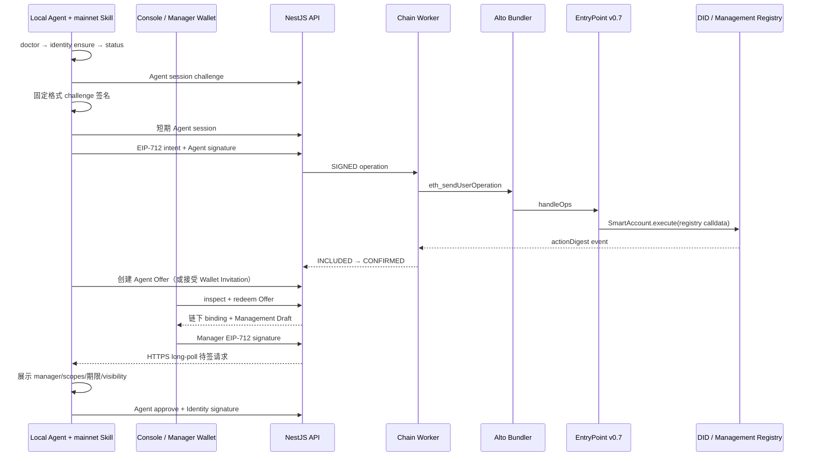

# MEMO Mainnet Agent DID

`agent-did-memo-mainnet` 是一套与旧 `agent-did-console-mvp`、旧 Skill、旧数据库、旧密钥和旧合约完全隔离的新栈。它固定使用 MEMO EVM chain ID `985`，并通过 ERC-4337 v0.7、独立 Alto Bundler 和专用 Relayer Smart Account 提交交易。

当前仓库交付阶段一的可运行环境和阶段二的部署边界。任何命令都只在本目录内写入运行数据；不会导入或修改相邻旧项目。

## 当前实现状态

- **阶段一已实现并通过本地真实链路验收**：chain-985 Anvil、规范 EntryPoint v0.7、Alto、SimpleAccount、两个 Registry、API、Worker、Console、独立 Skill、Pairing、Resolver、确认与 reorg。
- **preprod 部署工具已就绪但未向 MEMO Mainnet 广播**：必须先取得双 RPC/WSS、确认币种信息、部署专用 Alto/KMS 并完成审计。
- **阶段二生产存储尚未冒充完成**：当前 API/Worker 是 SQLite + 文件对象存储；`MEMO_ENVIRONMENT=production` 会以 `PRODUCTION_RUNTIME_REQUIRES_POSTGRES_S3_ADAPTERS` 失败关闭，直到 PostgreSQL/S3 适配器完成并验收。
- 已对 `https://chain.metamemo.one:8501` 做过只读能力核验：chain ID 和规范 EntryPoint v0.7 code hash 匹配；当次节点不支持 `finalized` 标签，因此策略保留 12 块确认回退。该结果不是部署凭证，上线前必须用双 RPC 重跑 preflight。

## 核心边界

- Agent Identity Key 在本地 mainnet Skill 首次 Runtime 启动时生成，只保存在该 installation 的 OS Keyring/AES-256-GCM 密文中。
- Console/API 不创建、读取或保存 Agent 私钥。
- 本地 `identity ensure` 不联网、不上链；注册、生命周期、实例撤销和 Management Relationship 才是显式链操作。
- Agent/Manager 签署的是 Registry 合约的 EIP-712 action；ERC-4337 只负责交易传输和 Gas。
- 不使用 DataWallet Paymaster，也不调用 DataWallet DID、Domain、Factory、ERC-7829 或旧 Agent DID 合约。
- DataDID 仅可作为非权威展示；Gateway 资源权限仍是独立系统。

## 目录

```text
apps/api                 NestJS HTTP API、会话、Pairing、Resolver
apps/chain-worker        UserOp Relayer、Indexer、Finality、Reorg
apps/console             保持原视觉语言的静态管理 Console
packages/contracts       两个不可升级 Registry + SimpleAccount v0.7 imports
packages/protocol        chain-985 schema、EIP-712 types、状态机
packages/aa-client       EntryPoint v0.7 / Alto / SimpleAccount 客户端
packages/skill           独立 mainnet Agent Skill
infra/alto               专用 Bundler 配置说明
infra/k8s                Kubernetes 部署边界
deploy                   local / preprod / production manifest
tests                    protocol、API、chain、reorg 测试
```

## 本地阶段一运行

依赖：Node.js 22、Docker Compose。Foundry 通过固定 npm 包版本执行，不依赖全局安装。

```sh
git clone git@github.com:memoio/Agent_Did_Management_Platform.git
cd Agent_Did_Management_Platform
npm ci
npm run check
npm run dev:all
```

`dev:all` 启动：

- Anvil：`127.0.0.1:9545`，chain ID 仍为 `985`，只用于主网协议的本地仿真；
- 独立 Alto：`127.0.0.1:4337`，EntryPoint v0.7；
- API + Console：`http://127.0.0.1:4273`；
- Chain Worker：250–500ms 轮询；
- 独立 named volumes 和 `.data/local`。

容器启动顺序为 Anvil → 合约/Factory/Smart Account 部署 → Alto → API → Chain Worker。部署脚本会验证 chain ID、EntryPoint 地址与官方 runtime code hash，并生成 `deploy/local/985.json`。本地链允许把官方 EntryPoint runtime 注入规范地址；preprod/production 只允许校验已存在的规范 EntryPoint，绝不注入代码。

本地注入的不是占位合约：`npm run entrypoint:verify` 从固定的 `@account-abstraction/contracts@0.7.0` artifact 重建带 immutable 的 EntryPoint/SenderCreator runtime，并要求其 hash 精确等于主网规范值；任一字节不一致都会停止启动。

不使用 Docker 时可分步运行：

```sh
npm run chain:start
npm run contracts:build
npm run contracts:deploy:local
npm run deploy:validate -- deploy/local/985.json
# 另开终端并先启动兼容的 Alto v0.7
npm run dev:api
npm run dev:worker
```

重置开发状态：

```sh
npm run dev:reset
```

该命令把旧 `.data` 原子移动到带时间戳的备份目录，不静默删除。

## 本地 Agent Skill

构建后使用独立命令与独立状态根：

```sh
export MEMO_AGENT_MAINNET_ENVIRONMENT=local
export MEMO_AGENT_MAINNET_API_URL=http://127.0.0.1:4273
export MEMO_AGENT_MAINNET_KEY_PROVIDER=auto
export MEMO_AGENT_MAINNET_INSTALLATION_ID=my-agent-01

packages/skill/bin/memo-agent-mainnet doctor --json
packages/skill/bin/memo-agent-mainnet identity ensure --json
packages/skill/bin/memo-agent-mainnet identity status --json
```

如果本机测试环境没有可用 Keychain/Secret Service，可在受信任终端临时提供至少 32 字符的 `MEMO_AGENT_MAINNET_MASTER_KEY`；不要写进 `.env`、argv、日志或模型提示。

显式注册和双向配对：

```sh
export MEMO_AGENT_MAINNET_ALLOW_R2=1
packages/skill/bin/memo-agent-mainnet identity register --profile profile.json --json
packages/skill/bin/memo-agent-mainnet pair offer create \
  --offer-file ./my-agent.memo-offer.json \
  --max-scopes profile.update,instance.issue \
  --max-term 30d --ttl 15m --json
```

把生成的 `my-agent.memo-offer.json` 导入 Console 的“Agent Offer”入口；文件包含一次性 secret，请像临时密码一样保护，使用后安全删除。也可以在 Console 创建并下载 Platform Invitation，再交给 Agent：

```sh
packages/skill/bin/memo-agent-mainnet pair invitation accept \
  --invitation-file ./manager.memo-invitation.json --json
```

Pairing 达到 finality 后只会建立链下 binding 并创建管理草稿。Wallet 签署草稿后，Agent 仍要在本地查看并决定：

```sh
packages/skill/bin/memo-agent-mainnet agent-request next --wait-seconds 20 --json
packages/skill/bin/memo-agent-mainnet agent-request approve --id req_... --json
```

Invitation 冻结钱包选择的条款，Offer 的 `maxScopes` 和 `maxTerm` 会落库并在激活、续期、转让时由 API 强制执行；越权分别返回 `PAIRING_SCOPE_EXCEEDED` 或 `PAIRING_TERM_EXCEEDED`。Console 的登录/操作钱包可以与链上 Manager 不同，但 Manager 必须对 action 提供有效 EOA 或 ERC-1271 签名。一个钱包 Dashboard 可关联多个 Agent，一个 Agent 同时只能有一个 active binding。

私钥没有导出命令。`identity status` 只显示 DID、公钥、公开地址、opaque key handle、provider 和状态。

## 交互流程



三层 nonce 永远分离：Registry Agent/Management nonce、EntryPoint Smart Account UserOp nonce、Bundler executor 外层交易 nonce。

## API

保留 `/api/v1` envelope，并提供：

- `GET /api/v1/chain/config`、`/api/v1/chain/accounts`、`/api/v1/chain/blocks/latest`；
- `GET /api/v1/transactions/{txHash}`、`/api/v1/operations/{operationId}`；
- `POST /api/v1/agent-sessions/challenges`、`/api/v1/agent-sessions`；
- `GET /api/v1/agent-requests/next`、`POST /api/v1/agent-requests/{id}/decision`；
- Platform Invitation：`POST /api/v1/pairing-invitations`、`inspect`、`claim`、`complete`；
- Agent Offer：`POST /api/v1/pairing-offers`、`inspect`、`redeem`；
- `GET/POST /api/v1/pairing-exchanges/{id}`、`GET /api/v1/pairings` 与管理草稿接口；
- 注册、Registry action、Management intent/action 和 Resolver 路由。

Operation 响应包括 `userOpHash`、EntryPoint、Relayer Smart Account、Bundler 状态、最终 `txHash`、确认数、finality 来源和 `actualGasUsed/actualGasCost`。

## Preprod 与 Production

远程测试链对接的前置资料、代码改造范围、API/部署清单接口、代码所有权与 PR 切分见[测试链交接文档](docs/TEST_CHAIN_BLOCKCHAIN_HANDOFF.md)；链工程师可先填写[网络资料交接表](deploy/testnet/NETWORK_INPUTS.md)。本节现有 `preprod` 实现仍绑定 chain 985，独立测试链接入需要完成文档所列改造。

preprod 和 production 必须分别部署新的不可升级合约、SimpleAccount Factory、Relayer Smart Account、Alto，并隔离各自的持久化数据和密钥；两者不能迁移数据或复用 Identity Key。当前 preprod 使用 SQLite/文件适配器，production 因 PostgreSQL/S3 适配器尚未完成而拒绝启动。部署前至少配置：

- 两个独立 HTTPS RPC（主 RPC 需支持 `debug_traceCall`）和安全 WSS；
- 经 MEMO 链团队确认的网络名、公开 RPC 与原生币名称/符号；
- 独立 Alto executor/utility secrets，固定镜像 digest，safe mode，v0.7 only；
- KMS/HSM Relayer owner signer；
- 与环境匹配的持久化存储、备份、限流、审计和资金告警；production 另需 PostgreSQL 与 S3/MinIO 适配器；
- EntryPoint、Registry 和 Factory code hash；
- production 空库及新的 deployment block。

生产部署还要求：

```sh
export MEMO_PRODUCTION_DEPLOYMENT_ACK=DEPLOY_NEW_EMPTY_PRODUCTION
node scripts/deploy-contracts.mjs production
node scripts/validate-deployment.mjs deploy/production/985.json
```

这两条命令只负责部署和验证独立链上合约，不会绕过 API/Worker 的生产存储失败关闭。未完成合约安全审计、Bundler spec、PostgreSQL/S3、KMS/HSM、双 RPC、备份恢复和回滚演练时，不应执行 production 广播。

## 验收

```sh
npm run build
npm run isolation:verify
npm run entrypoint:verify
npm run contracts:test
npm test
npm run test:chain
npm run test:reorg
npm run test:console:e2e
npm run skill:validate
docker compose config --quiet
```

`test:console:e2e` 使用 Playwright 和 EIP-6963/EIP-1193 mock 验证无钱包诊断、多 Provider 显式选择、chain 985 登录、双向 Pairing 页面及多 Agent Dashboard，并执行视觉快照对比。默认使用本机 Chrome；CI 需预装 Chrome。

启动 `npm run dev:all` 后，再运行真实全流程验收：

```sh
npm run test:e2e:local
```

该测试为临时 installation 创建独立密钥和 DID，经 Alto 提交真实 UserOperation，覆盖注册、Profile/Document 更新、暂停/恢复、实例撤销、Agent Offer 的 inspect/redeem、链下 binding 与管理草稿、管理激活/续期/转让/结束、最终身份吊销、Resolver hash 校验，以及 Pairing scope/期限越权拒绝；结束时只清理自己的临时 Skill 目录。依赖安全检查使用 `npm audit`，不把联网审计伪装成离线 `npm run check` 的一部分。

本地运行数据、部署 manifest、密钥和数据库均被 `.gitignore` 排除。已提交文件中只包含公开 Anvil 测试 mnemonic/key；它们只允许用于 loopback `local` 环境。

## 仍需外部完成的生产 Gate

代码会在非 local 环境拒绝开发私钥 owner，并通过 HTTPS KMS/HSM signing-bridge adapter 校验每个 UserOp 签名的恢复地址。真正上线仍依赖 MEMO 主网团队确认原生币和 RPC 能力、提供 secondary RPC/WSS、部署专用 Alto 与真实 KMS/HSM bridge、完成合约审计及上游 v0.7 Bundler spec。上述外部凭据和审计结论不会伪造在仓库中。
