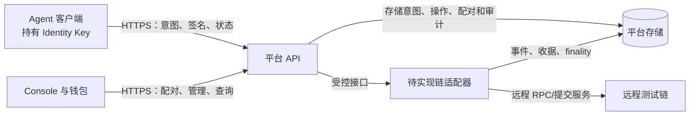

# Agent DID 管理平台：区块链实现需求与交接

> 文档状态：需求基线，目标测试链及链上技术方案待确认。当前仓库只提供 API/页面外壳，**没有合约、链客户端、Relayer、Indexer、Skill 或可用的身份服务**。本文件描述未来实现，不代表已上线。旧版链实现可从 Git 提交 `37da76aa4a725cf9b53c70c0b965fa4ffb1d1fb7` 查阅，不作为必须沿用的设计。

## 1. 目标、范围和交付原则

目标是让一个 Agent 拥有可验证的 DID，能由自身密钥控制身份；钱包可在 Agent 同意后建立有期限和范围的管理关系；平台能展示链上事实、操作状态和审计证据。客户端与链的交互应由平台 API 和明确的链适配器承接。

本阶段**所有部署、链查询、交易提交和端到端验收均连接远程测试链**。开发者可以在本机运行 API、页面和 Agent 客户端；不使用本地 Anvil/Hardhat 链代替测试链验收。离线单元测试可以使用模拟端口，但报告必须区分模拟结果和真实测试链证据。

新工程师可以选择 EVM 普通交易、ERC-4337 或经评审的其他传输方式。以下**功能、安全和可验证性要求必须满足**；合约拆分、Bundler 产品、Gas 支付者、链 SDK 等是待评审的技术决策。若选择非 EVM 链，先明确 DID 方法、签名算法、钱包兼容性及 API 字段差异，提交协议决策再编码。

## 2. 开发前由区块链工程师提供的资料

请先填写[测试链资料表](../deploy/testnet/NETWORK_INPUTS.md)，并给出只读验证结果。凭据、私钥、助记词、带 token 的 URL 不进入 Git 或聊天。

| 级别 | 必须提供 | 用途 |
| --- | --- | --- |
| 先决 | 测试链名称、chain ID/网络标识、genesis hash、重置政策、浏览器 URL | 防止与主网或另一测试链身份混淆；决定 DID 网络段和状态隔离 |
| 先决 | 两个独立的 HTTPS RPC、公开只读 RPC/WSS、访问白名单、速率与日志保留期 | 平台读链、故障切换、索引和钱包网络配置 |
| 先决 | 签名算法、钱包支持、交易/费用模型、合约或链上存储能力 | 确定 Agent 密钥、钱包管理签名与交易传输方案 |
| 先决 | finality 规则、推荐确认数、重组与链重置通知方式 | 操作状态机、事件索引和身份解析正确性 |
| 联调前 | 测试币来源、deployer/Relayer 地址、密钥管理/KMS 方案、资金和监控负责人 | 部署和持续提交；只交地址与密钥管理条目名 |
| 部署后 | 合约地址、ABI/接口版本、部署交易和区块 hash、runtime code hash、测试报告 | 平台只读部署清单、启动校验和审计 |

请提供“链上确实能运行目标方案”的最小原型证据：一个只读 RPC 查询、一次部署或等价写入、一次签名验证、一次最终交易收据。若采用 ERC-4337，另交 EntryPoint/Bundler 版本与 RPC 能力实测。若某项能力缺失，先给替代设计与影响，不要在平台代码里绕过校验。

## 3. 系统边界与责任

- **Agent 客户端**：创建并安全保存 Identity Key；验证完整签名域和动作内容后签名；不把私钥交给平台。`identity ensure` 只生成/读取本地身份，不能被表述为“已注册上链”。
- **平台 API**：管理会话、意图、幂等请求、Pairing 和查询；只接受签名与公开资料，返回可追踪的 operationId。平台不能代 Agent 签身份动作。
- **链适配器**：封装链连接、合约调用/交易传输、收据、事件、finality、重组和故障恢复。只允许它持有受控的链服务凭据。上层业务不直接拼接 RPC 或解析原始日志。
- **钱包**：签署管理授权、发起或接受 Pairing；若链需要钱包交易，必须向用户明确展示费用和动作。钱包与 Agent 是两类主体。
- **平台存储**：链下 Pairing、意图、operation 和审计必须与链上事实分开标记。链下状态不能冒充已确认链上关系。

部署清单由链工程师交付，API/适配器只读加载。公开 `GET /api/v1/chain/config` 只返回用户可见的网络名、网络标识、公开 RPC/WSS、合约地址、签名域和 finality；私有 RPC、签名服务 token 与密钥标识不出现在响应中。

## 4. 必须支持的业务能力

### 4.1 Agent 身份与 DID

1. Agent 首次初始化生成身份密钥和稳定安装标识。密钥在本机 Keychain、HSM 或加密存储中保存；重启后能找回同一公开身份。私钥不能被导出到日志、API 请求或前端。
2. 给同一安装实例生成稳定、可解析的 DID。DID 必须明确标识链网络；同一地址在不同链上不能被误认为同一个已注册身份。DID 方法字符串、大小写规范、密钥算法和版本由协议决策文档固定。
3. 注册时提交身份公开地址/公钥证明、DID Document hash、Profile hash 等必要字段；Agent 对**完整动作**签名。平台验证签名、网络、合约/命名空间、nonce、版本、过期时间和状态后才进入提交队列。
4. 注册成功需在达到约定 finality 后标记 `CONFIRMED`；解析接口返回公开 DID Document、Profile 摘要、状态、revision、链上证据与查询时的 finality，不返回私钥或未授权的个人资料。
5. 支持更新 Profile/Document、暂停、恢复、撤销及可评审的继任者声明。每个动作需独立授权、单调 revision 和防重放 nonce。永久撤销后不可通过“重试”恢复。
6. 如果同一 DID 已存在链上记录，平台应做幂等核对或拒绝冲突，不得悄悄创建新身份覆盖原身份。

### 4.2 Pairing 与管理关系

1. 支持两条链下发起路径：平台钱包生成一次性 **Invitation**，由 Agent 接受；或 Agent 生成一次性 **Offer** 文件，由钱包兑换。文件必须绑定平台 origin、目标网络、Agent/钱包可验证字段、有效期与一次性 handle。handle 是 bearer 凭据，不得打印在模型输出、日志、公开链接或错误响应中。
2. Pairing 只表示双方建立链下关联。页面与 API 必须将 `PAIRED` 和“链上管理关系已生效”分开显示。
3. 创建管理关系时，钱包和 Agent 分别签署同一规范动作。动作包含 Agent、Manager、权限范围、有效期、可发现性、nonce、revision、deadline 和目标链/合约域。缺一方签名不得提交。
4. 支持管理关系续期、结束、转移；转移涉及的参与者和所需签名须在协议中列明。管理权限不自动等于 Vault、Memory、Data 或 Gateway 资源权限。
5. 旧 Invitation/Offer 与旧网络、旧 Registry 或已过期的签名不能在新网络复用。并发兑换只能成功一次；重复请求返回同一个结果或明确冲突。

### 4.3 实例与证明

Agent 可以为运行实例签发短期实例凭证，Identity Key 与 Instance Key 分离。实例创建和日常挑战签名可保留链下；实例撤销、身份暂停等会影响可验证性的状态必须有可查询的权威来源。具体哪些状态上链、哪些只入平台审计，由链工程师与平台工程师共同给出字段级决策。

### 4.4 钱包和平台展示

Console 至少显示网络、DID 与身份状态、Pairing/管理关系、待签动作、operation 状态、交易与费用、事件及审计。链上事实必须带来源、tx/block hash、确认数或 finalized 依据；待提交、已包含、已确认不得合并为一个“成功”状态。错误网络、链不可用或未部署时，禁用写入入口并给用户明确原因。

## 5. 待实现的接口契约

以下是**目标接口**，当前外壳除状态/健康接口外均未实现。正式 schema、字段类型、鉴权范围和错误码须先由平台与链工程师联合评审，客户端按版本消费。

| 接口 | 使用者 | 最低输出/行为 |
| --- | --- | --- |
| `GET /api/v1/chain/config` | Skill、Console | 环境、网络标识、genesis/部署指纹、公开 RPC、签名域、合约地址、finality；配置未验证时返回 503 |
| `GET /api/v1/health`、`GET /api/v1/ready` | 运维 | 分别表示进程存活与链服务真正可写；主备 RPC/合约/Bundler 等故障使 ready 失败 |
| `POST /api/v1/agent-sessions/challenges`、`POST /api/v1/agent-sessions` | Agent | 短期一次性挑战与 Agent 签名验证；挑战绑定网络、域、过期时间 |
| `POST /api/v1/wallet-login-intents`、`POST /api/v1/wallet-sessions` | 钱包 | 钱包挑战、网络校验与会话；不接受错误 chain ID/签名域 |
| `POST /api/v1/registration-intents`、`POST /api/v1/agent-dids` | Agent | 完整签名意图、digest、nonce、截止时间；提交签名后返回 operationId；写请求带 idempotency key |
| `POST /api/v1/registry-action-intents`、`POST /api/v1/registry-actions` | Agent | Profile/Document/生命周期动作；与注册同等的签名和幂等校验 |
| `POST /api/v1/management-intents`、`POST /api/v1/management-actions` | 钱包、Agent | 管理动作与双方签名；必须验证参与者、scope、期限和 revision |
| `GET /api/v1/operations/:id` | 有权主体 | 状态、必要的提交标识、tx/block hash、确认数、失败原因和重组标记 |
| `GET /api/v1/agent-dids/:did` | 查询方 | 解析状态、链上证据、最终性及公开文档 |
| `pairing-invitations`、`pairing-offers`、`pairing-exchanges` | 钱包、Agent | 一次性文件交换与关联状态；敏感 handle 仅在创建/兑换所需的受保护响应出现 |

沿用统一响应外壳：成功 `{ "schema": "memo.agent-api-result/1", "ok": true, "data": ... }`；失败 `{ "schema": "memo.agent-api-result/1", "ok": false, "error": { "code": "...", "message": "..." } }`。错误码至少区分：网络不符、部署未验证、签名无效、nonce 已用、意图过期、权限不足、链不可用、提交状态不确定、重组、永远失败。HTTP 错误与异步 operation 失败不能混用。

推荐在平台与链适配器间定义明确的 TypeScript 接口，至少分为 `NetworkVerifier`、`IdentityRegistryReader`、`ActionSubmitter`、`ReceiptTracker`、`EventIndexer` 和 `FinalityEvaluator`。实现可以合并部署，但业务代码只依赖接口；所有链特定地址、ABI 与 RPC 方法封装在适配器内。接口方法需接受网络/部署指纹和 requestId，并返回可审计的区块来源。

## 6. 链上数据与协议约束

| 对象 | 必须有的字段或约束 | 目的 |
| --- | --- | --- |
| 网络身份 | chain ID/网络标识、genesis hash、部署版本和地址；任何重置都使旧部署失效 | 防止同 ID 的另一条链或重置后的链被误认 |
| DID 记录 | Agent 地址/公钥证明、状态、revision、Profile/Document hash、更新时间 | 解析可验证且更新有序 |
| 动作签名 | 明确 domain、action type、所有参与者、nonce、deadline、expected revision | 防重放、跨链/跨合约混用与越权 |
| 管理关系 | Agent、Manager、scope hash/规则、开始结束时间、状态、revision | 双方授权、限期管理和历史审计 |
| 事件 | 稳定事件名/版本、身份与关系索引字段、动作标识、revision、tx/log 位置 | Indexer 可从部署区块重放与去重 |
| 部署清单 | schema 版本、网络与 genesis、合约/提交服务地址、接口/代码 hash、部署 tx/block hash、finality | 启动前和每次写入前可校验环境 |

链工程师需提交 ABI/事件 schema、状态转移表、签名 typed data 或等价规范、权限矩阵、nonce 策略、升级/管理员权限说明和威胁模型。合约是否可升级由评审决定；若可升级，必须说明管理员、延迟、暂停、事件和兼容迁移；若不可升级，必须说明新版本如何并存或迁移。任何链上存储不得包含 Identity 私钥、Pairing handle 或用户不应公开的 Profile 原文。

## 7. 异步提交、finality 与故障恢复

目标 operation 状态：`CREATED → SIGNED → SUBMITTED → INCLUDED → CONFIRMED`，另有 `REORGED` 和 `FAILED`。具体允许的转移由状态机测试固定；不能因为某次 RPC 只返回旧区块，就把已确认记录更新成未确认。`CONFIRMED` 仅在验证到真实重组或部署失效时进入受控恢复流程，并保留原证据与审计记录。

- **幂等**：每次写入携带 idempotency key；相同主体+动作+key 返回同一 operationId，不同 payload 使用相同 key 返回冲突。未知提交结果先查询/对账，不能盲目重复签名或广播。
- **日志读取失败**：`eth_getLogs` 或等价事件读取失败时，不推进索引游标，不删除旧确认状态；用有上限的退避和抖动重试。恢复后从安全区块回填并按 tx hash、log index、block hash 去重。
- **重组**：保存 block number/hash 与 canonical 来源；检测父块不连续或已记录块 hash 变化时，回滚受影响投影、保留原审计，再从共同祖先回放。已确认状态的回退必须有可验证的链证据。
- **断线与重启**：进程重启后从持久化 operation/游标继续；主备 RPC 分叉、部署代码 hash 不符、链重置或签名服务不可用时停止新写入并显示不可用，不自动切换到另一网络。
- **超时**：提交被接受但未获得收据、收据已包含但未最终确认、deadline 到期三者分别处理；需要可追溯的失败原因和人工恢复步骤。

## 8. 安全和运维要求

1. Agent Identity Key 只由 Agent 客户端持有；服务侧交易资金账户与 Agent 身份密钥分离。私有 RPC、deployer、KMS/HSM、Bundler/executor 凭据经密钥管理器注入，均不写入仓库、容器镜像、前端配置或日志。
2. 客户端固定可信平台 HTTPS origin，并将平台返回的网络、genesis、Registry/签名域与本地预期值核对。不能仅凭平台响应决定“签哪个链”。
3. 平台按 Agent、钱包、租户分权；查询 operation、Pairing 与管理草稿不得越权。所有创建类接口有速率限制、体积限制、过期时间、幂等和审计。
4. 启动与写入前执行链身份、合约代码、部署清单、提交服务和资金健康检查。主备 RPC 应独立；公开配置不能泄露私有端点。
5. 数据库、对象存储、备份和迁移方案由平台团队与链团队共同验收。链上不可逆动作须在用户界面和客户端提示中明确说明；永久撤销、继任等高风险动作需独立授权策略。
6. 保留运行指标：RPC 错误率、区块落后量、索引游标、pending operation 时长、重组次数、余额与 Gas、签名服务失败、Pairing 过期与审计异常。链重置须有通知、清单作废和重新索引预案。

## 9. 分工、代码位置和合并顺序

当前树仅保留 `apps/api`、`apps/console` 的外壳。建议逐步新增以下目录；目录名是**协作边界建议**，不是已经存在的实现。

| PR | 主责 | 修改/新增范围 | 合入条件 |
| --- | --- | --- | --- |
| 0：链与协议决策 | 链 + 平台 + Agent | `deploy/testnet/NETWORK_INPUTS.md`、本文件、ADR（新增 `docs/adr/**`） | 目标链、网络指纹、DID、签名、Gas/提交方案、权限矩阵、finality 明确 |
| 1：链模块 | 区块链工程师 | 新增 `packages/chain-adapter/**`、`packages/contracts/**`（若需要）、`deploy/testnet/**` 中的非秘密模板、链模块测试 | 只依赖约定接口，提供 ABI/事件/部署清单/只读预检；不改 API 页面业务文件 |
| 2：平台接入 | 平台工程师 | `apps/api/src/**`、新增 `apps/chain-worker/**`、持久化与 API 测试 | 接口实现、鉴权、operation、Indexer、finality、重组与错误处理通过 |
| 3：客户端 | Agent/前端工程师 | `apps/console/**`、Agent Skill 独立仓库及必要的本仓库适配包 | 身份隔离、签名校验、Pairing、钱包体验与错误网络拒绝通过 |
| 4：远程测试链验收 | 三方 | 自动化 E2E、脱敏部署/验收报告 | 真实测试链注册、解析、管理和恢复证据齐全；无本地链替代 |

跨目录共享的接口 schema、DID 方法和状态机先走联合 PR，之后按文件所有权并行实现，减少冲突。旧代码仅供比对需求，不得把已经移除的 chain 985 常量、Anvil 私钥或未经验证的部署清单复制回新实现。

## 10. 验收清单

- [ ] 新工程师提交目标链资料表、技术 ADR、接口与安全评审；明确不使用本地链作为集成目标。
- [ ] 同一身份重启稳定；不同链/环境/Registry/平台 origin 不能串用身份或签名。
- [ ] Agent 签名注册并达到 `CONFIRMED`，DID 解析能独立校验链上证据；Profile/Document 更新与暂停/恢复/撤销符合状态机。
- [ ] Invitation 与 Offer 各完成一次配对；双方签名后管理关系才生效，越权/过期/重复兑换被拒绝。
- [ ] operation 幂等、未知提交结果对账、日志读取失败重试、重启续跑和重组恢复有自动化回归测试。
- [ ] 已确认状态遇到仅有未确认的更新时不降级；只有验证到真实链重组才回退并留下审计。
- [ ] 主备 RPC 分叉、链重置、合约代码变化、签名服务故障和资金不足时停止写入并返回明确错误。
- [ ] 远程测试链 E2E 报告记录 chain ID/genesis、清单 hash、DID、operationId、tx/block hash、确认数、解析结果和测试时间；不包含凭据。

当前外壳验证：`npm run check`；它只证明 API/页面外壳可构建并显式报告未接入，**不能**代替上述区块链验收。
