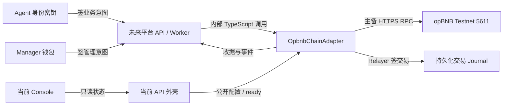

# Agent DID 管理平台：opBNB 测试链分支最新项目说明

> 审查基线：`feat/opbnb-testnet-chain`，提交 `dd4ff93`，2026-11-06。本文描述**仓库实际代码及可取得的证据**。这条分支已经实现链模块，但截至该提交未部署新的 Agent 合约，平台尚不能通过 HTTP 完成 DID 注册。旧 `main` 的交接契约仍是验收基线。本文不是合约安全审计或远程链端到端验收报告。

## 1. 给接手者的结论

本次开发把原来的空白区块链接入位置，补成了可编译的 **Solidity 合约 + TypeScript 链适配器 + 受控部署/调用脚本**。目标网络在代码中固定为 opBNB Testnet，chain ID `5611`，交易方式选用普通 Relayer 支付 Gas。Agent 和 Manager 对 EIP-712 业务动作签名，Relayer 仅负责提交交易。平台 API 目前只接入链配置、就绪与集成状态的**查询**；注册、管理、解析、配对等业务仍需平台团队开发。

| 层级 | 当前状态 | 判断依据 |
| --- | --- | --- |
| 链网络 | opBNB Testnet 参数已写入代码；分支文档记录两次公开 RPC 只读观测 | `config.ts`、`OPBNB-TESTNET-INTEGRATION.md` |
| 合约 | DID 与管理关系两份合约、ABI、编译脚本已提交；无远程部署地址 | `packages/contracts/**`、交接清单 C-05 未完成 |
| 链适配器 | 部署验证、读链、意图、验签、模拟、估算、提交、收据、事件、最终性及恢复辅助已有实现 | `packages/chain-adapter/src/**` |
| API / 页面 | 进程健康、集成状态、链公开配置、写就绪检查；静态页面展示状态 | `apps/api/src/**`、`apps/console/public/**` |
| 业务系统 | 注册/更新/管理 HTTP 路由、鉴权、持久化 Worker、Indexer、对象存储、Pairing、Agent Skill 未接入 | API 控制器只有四个 GET 路由；交接清单 I-02～I-06 待接入 |
| 远程验收 | 未见新合约部署清单、部署 tx、真实 Agent 注册 tx 或业务 E2E 证据 | 分支交接文档明确 C-05/C-08 待交付 |

## 2. 目录与执行路径

| 位置 | 作用 | 责任边界 |
| --- | --- | --- |
| `packages/contracts/src/AgentDIDRegistry.sol` | 身份注册、内容 hash 更新、暂停/恢复/永久撤销、实例凭证撤销 | 链上权威身份状态 |
| `packages/contracts/src/AgentManagementRegistry.sol` | 一条当前管理关系的建立、续期、单方结束、三方转移 | 链上权威管理关系状态 |
| `packages/contracts/artifacts/`、`compile.mjs` | ABI、字节码、编译配置；Solidity 0.8.28、OpenZeppelin 5.1.0、Paris EVM | 编译/部署工件 |
| `packages/chain-adapter/src/protocol.ts` | JSON/JCS hash、scope/标识符 hash、DID 和 EIP-712 intent | 平台/Agent 须独立复核的协议规则 |
| `packages/chain-adapter/src/manifest.ts` | 部署清单、意图、事件 Schema 验证和 ABI hash 检查 | 拒绝错误部署 |
| `packages/chain-adapter/src/adapter.ts` | 双 RPC 验证、读写、验签、事件、最终性 | 平台内部链入口 |
| `packages/chain-adapter/src/config.ts` | 网络常量、主备 provider、服务签名器、写入预算、受控清单加载 | 服务端运行配置 |
| `packages/chain-adapter/src/journal.ts`、`recovery.ts` | 原始签名交易持久化、进程锁、索引窗口和 operation 转移辅助 | 平台需接持久化 Worker/Indexer |
| `scripts/chain/` | 预检、部署、基础链调用 CLI | 运维与链工程师使用；不是公共业务 API |
| `apps/api/src/chain.service.ts`、`api.controller.ts` | 当前四个只读 GET 路由 | 平台业务接口尚待实现 |
| `tests/chain/` | Ganache 离线合约/适配器故障测试及协议向量 | 不等于远程 opBNB 验收 |

## 3. 协议和链上模型

**DID** 格式为 `did:memo:agent:5611:<小写以太坊地址>`。Agent 使用 secp256k1 EOA；身份合约拒绝合约 Agent。注册动作携带 Agent 地址、`identityPublicKeyHash`、Document/Profile 的 32 字节 hash、当前 revision/nonce 与截止时间。Profile/Document 原文不入链，平台后续按 JCS 规范化再做 SHA-256 并保存原文。公钥 hash 定义为未压缩公钥坐标 `X||Y` 的 keccak256。

两份 Registry 都用 EIP-712 域隔离签名：身份域 `MEMO Agent DID Registry`，管理域 `MEMO Agent DID Management`，版本均为 `1`；`chainId` 和 `verifyingContract` 来自经验证的部署清单。具体 11 个动作的字段、类型与顺序以 [`action-types.json`](../specs/chain-integration-v1/action-types.json) 为机器基准。

| 身份动作 | 签署人 | 链上效果 |
| --- | --- | --- |
| `RegisterAgent` | Agent | `NONE→ACTIVE`，revision/nonce 从 `0/0` 到 `1/1` |
| `UpdateProfile`、`UpdateDocument` | Agent | 更换相应 hash，增加 revision/nonce |
| `SuspendAgent`、`ResumeAgent` | Agent | `ACTIVE↔SUSPENDED` |
| `RevokeAgent` | Agent | 永久 `REVOKED`，不能恢复或覆盖注册 |
| `RevokeInstanceCredential` | Agent | 按 `(Agent, credentialIdHash)` 记录撤销，重复拒绝 |

| 管理动作 | 所需签名 | 链上效果 |
| --- | --- | --- |
| `ActivateRelationship` | Agent + Manager | 建立当前关系及 scope hash、期限、可发现性 |
| `RenewRelationship` | Agent + 当前 Manager | 更新当前关系的 scope、期限、可发现性 |
| `EndRelationship` | Agent **或**当前 Manager | 单方结束；原因码受限制 |
| `TransferRelationship` | Agent + 原 Manager + 新 Manager | 原子替换为新关系，一次 nonce/revision 增量 |

每个 Agent 最多一条当前关系，历史由事件保留。管理 Registry 的 nonce/revision 与身份 Registry 分开。Manager 可为普通钱包或 ERC-1271 合约钱包。关系的 `live` 还要求 Agent 当前 `ACTIVE`、关系未结束且未过期；Pairing、Gateway/Vault 授权不由这两份合约实现。合约不可升级，无管理员代签后门；版本变更需要新地址、部署 ID 与迁移评审。

**审查注意**：链上注册检查 `identityPublicKeyHash` 末 20 字节与地址一致并验证该地址签名，但合约未收到公钥原文，因此无法在链上独立证明该 hash 确实由公钥坐标计算。未来平台/Agent 注册入口必须独立校验公钥、hash、地址及会话一致；不能把合约的地址绑定检查表述为完整公钥证明。

## 4. 链适配器的实际行为

1. `configuredChain` 从仓库外清单和独立 SHA-256 加载部署元数据；`verifyDeployment` 核对主备 RPC 的 chain ID、genesis、同高度区块、合约代码 hash、部署收据、EIP-712 域及 Management→DID Registry 引用。任一关键不符时拒绝使用。
2. `readIdentity`、`readRelationship`、`readCredentialRevocation` 在双 RPC 一致的块上读取，并返回来源 block/hash。`buildIntent` 从链上读 revision/nonce，填截止时间，生成不可变 EIP-712 digest。`verifySignedAction` 检查部署、期限、快照、nonce/revision、所需角色与 EOA/ERC-1271 签名，再模拟合约调用。
3. `estimateSignedAction` 只估算并返回 L2 Gas、上限和 `broadcast=false`；`submitSignedAction` 在写权限、签名、资金和预算检查后，先将原始签名交易 fsync 保存到 Journal，再广播。相同 `requestId` 只能恢复原交易；`SUBMISSION_UNKNOWN` 不应被当作失败后重新签动作。
4. `getSubmission` 通过主备收据、规范块与匹配事件核对交易；最终性按清单的 `finalized-tag` 或确认数判断。`readEvents` 分块查询并比较两个节点的日志，只有全部读取和首尾块 hash 复核成功才返回 `complete=true`。`readNextWindow`、`advanceOperation` 提供游标及状态转移辅助函数，平台仍须自行持久化事务、审计和重组回放。

当前 `FileSubmissionJournal` 是**单 Relayer、单私有持久卷**设计，使用文件锁阻止并发提交；不能直接把多个服务实例用不同卷连接到同一 Gas 账户。Journal 含可再次广播的原始签名交易，应按秘密材料保护。容器临时盘、日志、Git 均不适合保存它。

## 5. opBNB 环境与启动条件

分支给出的网络信息：CAIP-2 `eip155:5611`，公开主 RPC `https://opbnb-testnet-rpc.bnbchain.org`，公开备 RPC `https://opbnb-testnet-rpc.publicnode.com`，浏览器 `https://opbnb-testnet.bscscan.com`，Gas 币 tBNB。`config.ts` 固定 genesis hash；文档记录两次只读检查，但这些观测不证明长期独立性、SLA 或正式最终性策略。

**只读启动**至少需要真实新合约的部署清单路径及其独立 SHA-256。**写入就绪**还需 `MEMO_CHAIN_WRITES_ENABLED=true`、服务端 Relayer 私钥或外部 signer 模块、与 signer 一致的公开地址、仓库外 `MEMO_SUBMISSION_DIRECTORY`、正数余额下限、Gas 价格/用量上限及经批准的最终性参数。`.env.example` 只放公开测试 Gas 地址和空密钥占位；不得把私钥写入仓库。当前提交没有可用部署清单，故普通启动的 `/ready` 与 `/chain/config` 应返回 503。

| 命令 | 行为 |
| --- | --- |
| `npm ci`；`npm run check` | 安装锁定依赖；编译合约/TypeScript 并运行离线测试 |
| `npm run dev` | 启动 API 外壳和静态页面，默认 `127.0.0.1:4273` |
| `npm run chain:preflight` | 双 RPC 只读网络/部署预检；脚本依赖已构建的 `dist` |
| `npm run chain:deploy` | 默认预览，不广播；`-- --execute` 才创建两份合约并消耗 tBNB |
| `npm run chain:call -- <command> [input.json]` | 配置、就绪、身份/关系查询、intent、Gas 估算、提交和回执；`submit` 还需 `--execute` |

调用脚本要求调用者自行准备已签的 JSON、持久化 `requestId` 和保护签名文件；它不是面向 Agent 的受鉴权平台 API。部署脚本会在写前保存检查点、检查源码干净、预算和双 RPC，并在成功后生成清单与验证报告。部署操作必须由有权限的运维人员在批准 G0～G2 后执行。

## 6. 当前 HTTP API 与尚缺的业务闭环

| 当前 GET | 返回含义 |
| --- | --- |
| `/api/v1/health` | 仅表示 API 进程活着 |
| `/api/v1/integration/status` | 目标网络与配置/连接/写就绪状态；错误被归类 |
| `/api/v1/chain/config` | 真实部署通过校验后公开网络、合约域和能力；缺清单时 503 |
| `/api/v1/ready` | 部署验证、服务 signer、余额和写配置检查；缺项时 503 |

平台下一步应按[集成契约](BLOCKCHAIN_INTEGRATION_CONTRACT.md)实现 Agent/钱包会话、注册和动作 intent/提交、管理多方签名采集、operation 查询与状态机、DID Resolver、数据库/对象存储、Indexer、Pairing、Console 和 Skill。平台必须让 Agent/钱包核对签名域、链和业务字段，并且仅在收据与最终性证据齐全后显示 `CONFIRMED`。没有 HTTP 业务路由时，CLI 能构建/提交链动作不代表 Agent 用户能走完整流程。

## 7. 本次审查发现与建议

| 优先级 | 发现 | 影响 / 建议 |
| --- | --- | --- |
| 高 | 新合约未远程部署，C-05/C-08 与 G3/G4 尚无证据 | 无法核对真实 runtime code hash、注册/管理交易、远程收据和 Resolver；先完成安全评审、部署清单和真实链验收 |
| 高 | 平台业务路由、鉴权、持久化 Worker/Indexer、对象存储、Pairing、Console/Skill 未实现 | 当前只可运维 CLI 与只读状态查询；按 I-02～I-06 分 PR 接入 |
| 中 | `readiness()` 检查 Journal 对象存在，但未实测持久卷可写、可 fsync 和锁是否可取得 | 就绪可能显示成功而首次提交失败；运维需验证卷权限和容量，平台接入时增加可写性检查 |
| 中 | 合约只能核验 `identityPublicKeyHash` 与地址的末 20 字节关系，无法单独核验公钥原文 | 注册 API 必须校验 Agent 提供的公钥及其 hash，并把验证结果写入测试 |
| 中 | 离线主备 provider 在测试中指向同一个 Ganache 服务；远程文档只有只读观测 | 故障注入覆盖部分分叉情形，但正式双节点独立性、历史日志、限流、finality 和真实重组仍需运维/远程验收 |
| 低 | `NETWORK_INPUTS.md` 开头仍称交易方式待选；`DELIVERY_CHECKLIST.md` 结尾仍称目标链未选定 | 与已经固定的 opBNB/direct-relayer 不一致，合入前更新文案，避免交接误读 |

## 8. 验证证据与下一步门槛

分支内 `tests/chain/` **声明并实现了**两份合约全部 v1 动作、协议向量、错误网络/签名/nonce、ERC-1271、日志读取失败重试、广播响应丢失、游标恢复、已确认状态不降级及模拟重组的离线测试。测试是合成环境，且目前尚缺安全审计、镜像构建和远程业务 E2E。

**本机复核结果**：初次 `npm run check` 在 Solidity 编译入口失败，原因是新分支依赖尚未安装，Node 报 `ERR_MODULE_NOT_FOUND: solc`。随后执行 `npm ci`，锁文件中部分包的 `resolved` 指向 `registry.npmmirror.com`，本机 DNS 返回 `ENOTFOUND`；临时把 23 处镜像下载地址改为官方 npm registry 后再试，安装仍长时间无响应，故停止并**完整恢复原始锁文件**。因此本次未得到合约编译、TypeScript 编译和测试的独立通过证据。原分支文档中的“本地验证通过”属于链工程师原报告，不能替代本次复核。建议在可访问 npm 的 CI/开发环境用未改动的锁文件重新执行 `npm ci && npm run check`，并保存完整日志；若镜像持续不可达，先由工程师修正锁文件来源并单独评审。

建议按下列顺序进入联调：① 三方冻结协议向量与权限；② 运维定主备 RPC、测试 Gas、签名服务、finality 和持久卷；③ 安全复核合约与适配器并部署两份新合约，交清单/hash；④ 平台接入业务 API、Worker 和 Indexer；⑤ Agent/钱包/Console 完成签名与 Pairing；⑥ 在真实 opBNB Testnet 上保存注册、解析、管理、故障恢复的 tx/block/digest/operationId 证据，按[验收单](../deploy/testnet/DELIVERY_CHECKLIST.md)签署 G3/G4。
