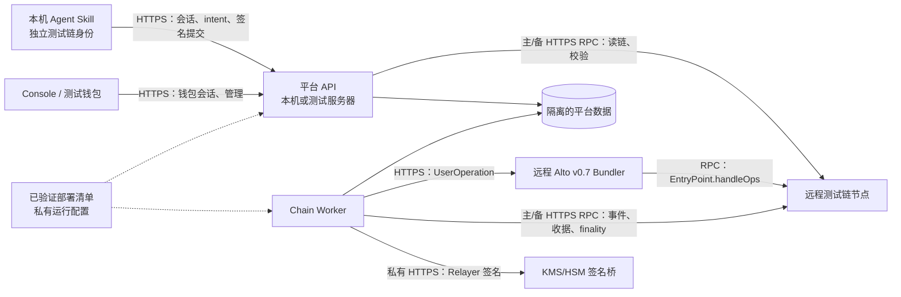

# Agent DID 远程测试链对接与区块链工程交接

> 状态：目标链尚未选定；本文是实施方案，现有代码尚不能只靠修改环境变量接入独立测试链。链工程师请先填写 [`deploy/testnet/NETWORK_INPUTS.md`](../deploy/testnet/NETWORK_INPUTS.md)。本文中的占位符不是实际配置。

## 1. 已确定的边界

- 所有**链上查询、部署、发交易、Bundler 提交和端到端联调**都连接同一条远程测试链。不启动 Anvil，不使用 `deploy/local/985.json`、本地助记词、`docker-compose.yml` 中的 Anvil/Alto 开发配置，也不把主网 985 当作测试链。
- Agent Skill、API、Worker、Console 可以运行在开发者电脑或测试服务器；“程序运行在本机”不等于“区块链运行在本机”。它们分别通过平台 API、远程 RPC、远程 Bundler 与签名桥工作。
- 建议继续用 `preprod` 表示**平台部署环境**，用独立的 chain ID、genesis hash 表示**测试链网络**。这是一项待实现的改造；目前 `preprod` 仍锁定在 chain 985。若团队另选 `testnet` 环境名，还要同步扩展所有环境枚举和状态隔离逻辑。
- 测试链必须拥有与主网 985 不同的 chain ID；若链方只能提供另一个 chain ID 985 的网络，先共同设计不歧义的 DID 网络标识、签名域和状态隔离，再进入开发。建议优先选唯一 chain ID 的测试链。
- 原本在本地模拟链创建的 `did:memo:agent:985:…`、installation ID、密钥、配对文件和平台数据均不迁移到测试链。为测试链建立独立的 Agent 状态目录、安装标识、钱包与平台数据。保留旧状态，不能因新链失败而覆盖或重建旧身份。

`preprod` 非本地模式已有 HTTPS 和 KMS/HSM 等安全门槛，但协议、部署清单 schema、Skill、API 与 Worker 多处硬编码 985。`production` API/Worker 因 PostgreSQL/S3 适配器未完成会主动拒绝启动。本项目目录当前也不是 Git checkout；多人 PR 前须选定共享远端仓库与基线提交。独立发行的 `memoio/agent_did_skill` 需要单独同步。

## 2. 链工程师**先提供什么**

先给第 2.1 节的公开资料，平台团队才能确定协议和代码范围；第 2.2 节的凭据与部署证明在联调前补齐。请直接填写[网络资料模板](../deploy/testnet/NETWORK_INPUTS.md)，资料版本与负责人写在模板顶部。带 token 的 RPC URL、私钥及密钥材料经密钥管理器交付，**不要填在模板、Git、聊天或截图中**。

### 2.1 开始编码前的最小资料包

| 优先级 | 链工程师提供 | 用途 / 可验证证据 |
| --- | --- | --- |
| 必须 | 链的正式名称、测试网标识、**十进制和十六进制 chain ID**、genesis block hash、是否会重置及通知机制、浏览器 URL | 确定 DID 命名与网络隔离；主备 RPC 的 `eth_chainId`、`eth_getBlockByNumber(0)` 一致 |
| 必须 | 两个**独立**的私有 HTTPS RPC 接入方式、公开只读 HTTPS RPC、公开 `wss://`、白名单/配额/限流/历史日志保留期 | API/Worker 主备读链、Console 加网络、事件索引；主备在相同高度返回相同 block hash |
| 必须 | 节点的 `eth_getCode`、`eth_getLogs`、`eth_getTransactionReceipt`、`eth_feeHistory` 或可用 fee data、`debug_traceCall` 能力；`finalized` 标签能力 | 现有预检、Alto safe mode、交易收据和重组处理所需；请给脱敏的 JSON-RPC 实测结果 |
| 必须 | ERC-4337 **v0.7 EntryPoint** 是否已在 `0x0000000071727De22E5E9d8BAf0edAc6f37da032` 部署；实际 runtime code hash；SenderCreator 状态 | 代码固定校验 EntryPoint v0.7 地址和 hash；没有规范部署时需链团队先落实部署方案，不能在远程链用 `anvil_setCode` |
| 必须 | 是否有可用的**远程 HTTPS Bundler**；`eth_supportedEntryPoints` 结果；由谁部署/维护 Alto、executor/utility | 确定是否需要链/基础设施工程师交付专用 Bundler |
| 必须 | 原生币名称、符号、精度、测试币领取/充值方式；推荐确认数、预期出块时间、正常重组深度 | 部署和 Relayer 资金、钱包配置、finality 策略；当前 manifest 校验精度为 18，其他精度需共同改造 |
| 必须 | EVM 硬分叉兼容性、Gas 计价机制、Solidity 合约部署限制 | 项目合约使用 Solidity 0.8.37、`evm_version=paris`、via IR 编译；链方需确认可部署并运行构建出的字节码 |
| 必须 | 链团队联系人、RPC/Bundler 运维联系人、故障渠道；部署权限与预计测试资金 | 明确谁提供网络、谁部署合约、谁处理重置/停机 |

**最小启动门槛**：chain ID + genesis、可访问的主备 RPC、EntryPoint v0.7 状态、Bundler 可用性、原生币与重置政策。缺其中任一项，只能先做离线接口设计，不能声称已经接通测试链。若链尚未定，请先由链工程师比较候选链并给出这些资料，不要先把 `985` 全局替换成任意数字。

### 2.2 首次部署和端到端联调前补齐

| 类别 | 交付内容 |
| --- | --- |
| 部署者与资金 | Deployer 地址、测试币充值方法与预算；Relayer Smart Account owner 地址、KMS/HSM provider；Alto executor/utility 地址、余额下限、EntryPoint deposit 策略。仅交付地址与方式，凭据走密钥管理器 |
| 签名桥 | 私有 HTTPS endpoint、可用网络路径、鉴权方式、key ID 的管理流程；确认支持第 6 节的 EIP-191 字节消息语义，给可核验的测试签名和 owner 地址 |
| Bundler | 版本/源码提交或镜像 digest、v0.7 only、安全模式配置、RPC 来源、服务容量与监控；实测 `eth_estimateUserOperationGas`、`eth_sendUserOperation`、`eth_getUserOperationReceipt` |
| 合约部署 | 新 DID Registry、Management Registry、Factory、Relayer Smart Account 的地址、部署 tx hash、block number/hash、runtime code hash、ABI hash、Relayer owner；附只读在线校验报告 |
| 运维 | RPC/Bundler/签名桥健康检查、告警、密钥轮换、链重置通知与旧部署清单作废流程；公开 API/Console 的 HTTPS origin 与证书方案 |

链上合约地址和部署证据在实际部署后提供；在编码前可以先标记为“待部署”。不要把尚不存在的地址填成零地址或本地旧地址。

## 3. 目标架构：本机程序，远程测试链



Skill 和 Console 只调用平台 API；浏览器钱包为切换/添加测试网络可读取**公开** RPC。API/Worker 使用私有主备 RPC；Worker 通过 Bundler 提交 UserOperation，并用 KMS/HSM 签署 Relayer Smart Account 操作。Agent Identity Key 留在 Skill 所在主机，不进入 API、Worker、Bundler 或签名桥。Pairing Invitation/Offer 属链下文件交换，不是链上注册。

`GET /api/v1/chain/config` 是现有公开配置接口，返回 chain ID、网络名、公开 RPC/WSS、EntryPoint、合约地址、EIP-712 domain 与 finality；`GET /api/v1/health` 给出链与 Bundler 健康状态。私有 RPC、Bundler 鉴权、deployer 凭据与 KMS token 仅从私有配置/密钥管理器注入。**不必为了隐藏 RPC 再建一个新的“区块链代理 API”**；客户端的区块链业务操作已经通过平台 API 编排，部署配置则通过受控清单交接。

若 API 在开发者本机运行，Skill 的 `preprod` 模式目前仍要求**可信 HTTPS API origin**及 allowlist；普通 `http://127.0.0.1:4273` 会被拒绝。需提供受信任的本机 HTTPS 反向代理或测试域名，并将其列入 `MEMO_AGENT_MAINNET_API_ORIGINS`。这是 API 的传输要求，与远程测试链 RPC 地址不同。

## 4. 当前阻塞点和修改范围

下表反映**当前代码**，不是已实现的测试链支持。以文件所有权拆 PR，公共协议改动单独评审。

| 工作包 / 负责人 | 具体文件 | 必须改什么 |
| --- | --- | --- |
| 公共协议；平台主导、链工程师评审 | `packages/protocol/src/index.ts`、`deploy/manifest.schema.json` | 将 `CHAIN_ID=985`、`chainId: 985`、`did:memo:agent:985:` 解析、EIP-712 domain、Pairing 包和 manifest 校验改为**受信任网络配置**；保持主网 985 的既有校验；明确 `did:memo:agent:<测试链ID>:<address>` 是否为正式规则，并让所有签名端采用同一规则 |
| 网络预检；链工程师 | `scripts/preflight-mainnet.mjs`，建议新增 `scripts/preflight-testnet.mjs`；`scripts/verify-entrypoint-artifact.mjs` | 参数化链 ID、genesis、EntryPoint hash 与 RPC；检查两个独立 RPC 的同链同块、trace/fee/receipt/log、Bundler v0.7 和 finality；输出可归档的脱敏结果，不将固定 985 的主网预检直接改坏 |
| 合约与部署；链工程师 | `packages/contracts/src/**`、`packages/contracts/test/**`、`scripts/deploy-contracts.mjs`、`scripts/validate-deployment.mjs`、`deploy/testnet/**`（新增） | 如合约接口无变更，优先复用并在远程测试链**重新部署**；部署脚本从明确的网络配置选链、校验 genesis/EntryPoint，产出含 tx/block/code/ABI hash 的清单；旧清单不匹配时拒绝复用。合约函数、事件或 EIP-712 类型变动需先联合定协议版本 |
| Bundler；链/基础设施工程师 | `infra/alto/**`，建议新增 `infra/testnet/**` | 使用远程 RPC 与独立 executor/utility，v0.7 only、safe mode、受控密钥与监控；不能直接搬用 `docker-compose.yml` 的 Anvil 配置或开发私钥 |
| API 与 Worker；平台工程师 | `apps/api/src/config.service.ts`、`api.controller.ts`、`session.service.ts`、`intent.service.ts`、`resolver.service.ts`、`store.service.ts`、`chain-health.service.ts`、`apps/chain-worker/src/worker.ts`、`packages/aa-client/src/index.ts` | 由**已校验清单**读取测试 chain ID/部署地址；钱包挑战、CAIP-10、DID、RPC provider、事件索引与 UserOp 均使用同一网络；增强 `ChainWriteGuard` 对 genesis、部署区块 hash 和代码 hash 的检查，错误链或链重置时阻止写入 |
| Agent Skill 与 Console；Agent/前端工程师 | `packages/skill/src/config.ts`、`signer.ts`、`service.ts`、`policy.ts`、`apps/console/public/app.js`；另需独立 `memoio/agent_did_skill` 仓库 PR | Skill 现在把 chain 985、主网命名空间及身份绑定写死，Console 钱包登录也直接比较 985；需要独立测试链身份状态、固定预期 chain ID/genesis/Registry/API origin，更新钱包网络与 EIP-712 校验；不降低 R2/R4 授权门槛 |
| 部署与文档；平台/运维 | `.env.example`、`README.md`、`deploy/testnet/**`、测试环境编排文件（新增） | 增加**远程测试链专用**环境模板和启动文档；API/Worker/Skill 数据独立，所有链端点都非 Anvil；真实 `.env` 与密钥不入库 |

`packages/contracts/out/`、`dist/`、`.data/`、生成的实际部署清单和密钥不作为源码 PR 提交。部署清单应作为带 SHA-256 的不可变发布工件，在 API/Worker 只读挂载。`docker-compose.yml` 当前是本地 Anvil 环境；如需容器化本机 API/Worker，新增测试链专用编排，**不要**仅修改旧 Compose 的 RPC URL。

### 4.1 必须防止“改了 RPC，身份仍指向 985”

当前至少有以下固定校验：`packages/protocol/src/index.ts` 的 DID/签名/manifest，`packages/skill/src/config.ts` 的 985 限制，`apps/api/src/session.service.ts` 的挑战与 CAIP-10，`apps/api/src/api.controller.ts` 的钱包登录，`apps/chain-worker/src/worker.ts` 的 RPC provider，`apps/console/public/app.js` 的钱包 chain ID，`scripts/deploy-contracts.mjs` 与 `scripts/validate-deployment.mjs` 的 985。还须搜索 API、Skill、测试和文档中的其他 `985`，逐处判断其是主网常量还是应来自网络配置；不能全局替换数字。

## 5. 配置与接口约定

### 5.1 网络资料 → 部署清单 → 平台 API

1. 链工程师先交[网络资料模板](../deploy/testnet/NETWORK_INPUTS.md)和只读预检结果。平台与链工程师共同确认 chain ID、genesis、EntryPoint、finality、DID 命名与合约接口。
2. 链工程师部署全新合约，生成并在线验证 `memo.agent-did-deployment/1` 清单；建议联合升级 schema，加 `genesisHash`、每个合约的部署 tx hash/block hash、清单版本与校验值。**这是建议字段，当前 schema 尚未实现。**
3. API/Worker 从同一份只读清单和私有配置启动；启动前后核对主备 RPC chain ID/genesis、部署锚点和代码 hash。Skill 从 `/api/v1/chain/config` 获得公开字段，但还要与本机**预先固定**的预期网络/Registry/API origin 比较，不能只信任远端响应。
4. 客户端调 `POST /api/v1/registration-intents` 获取完整 EIP-712 intent，本地重建 digest 后签名；再调 `POST /api/v1/agent-dids` 提交签名；用 `GET /api/v1/operations/:operationId` 等待 `CONFIRMED`，最后 `GET /api/v1/agent-dids/:did` 解析。Worker 负责 Bundler、收据、finality 与 reorg。

现有成功响应包装为 `{ "schema": "memo.agent-api-result/1", "ok": true, "data": { … } }`。链配置公开字段的形状以 `apps/api/src/config.service.ts` 为准，包括 `environment`、`chainId`、`networkName`、`rpcUrl`、`wssUrl`、`entryPoint`、`contracts`、`requiredConfirmations`、`finality`。增补链指纹字段需同步 API 类型、Skill 校验与 Console。

### 5.2 私有签名桥

非 `local` 模式要求 Relayer owner 由 KMS/HSM 管理。现有 `RemoteKmsDigestSigner` 发送 `requestId`、`provider`、`keyId`、`algorithm: "secp256k1-eip191"`、32 字节十六进制 `digest`；响应 `signature`（65 字节 Ethereum 签名）和可选 `address`。适配器以 `verifyMessage(getBytes(digest), signature)` 恢复 Relayer owner，因此签名桥必须签**同样的 EIP-191 字节消息**，不能改为直接签裸 digest。签名桥只签 Relayer UserOperation，不接触 Agent Identity Key。

### 5.3 配置模板：改造完成后使用

以下展示**拟使用的字段**；当前代码仍固定 985，复制此段不能直接启动测试链。`preprod` 表示平台阶段，实际网络由已验证清单与固定 chain ID/genesis 决定。若本机运行 API，另需受信任 HTTPS 入口。

```dotenv
MEMO_ENVIRONMENT=preprod
MEMO_CHAIN_ID=<远程测试链的十进制 chain ID；当前代码不读取它来切链>
MEMO_NETWORK_NAME=<远程测试链名称>
MEMO_PRIMARY_RPC_URL=https://<私有主 RPC>
MEMO_SECONDARY_RPC_URL=https://<独立私有备 RPC>
MEMO_BUNDLER_URL=https://<远程 v0.7 Bundler>
MEMO_PUBLIC_RPC_URL=https://<公开只读 RPC>
MEMO_PUBLIC_WSS_URL=wss://<公开 WSS>
MEMO_NATIVE_CURRENCY_NAME=<链方确认>
MEMO_NATIVE_CURRENCY_SYMBOL=<链方确认>
MEMO_NATIVE_CURRENCY_DECIMALS=18
MEMO_REQUIRED_CONFIRMATIONS=<链方建议并经平台确认>
MEMO_DEPLOYMENT_MANIFEST=/secure/deploy/testnet/<chain-id>.json
MEMO_DATA_ROOT=/secure/data/testnet-<chain-id>
MEMO_PLATFORM_ORIGINS=https://<Console 域名>
MEMO_RELAYER_OWNER_PROVIDER=kms
MEMO_RELAYER_OWNER_ADDRESS=0x<40 位地址>
MEMO_RELAYER_SIGNER_ENDPOINT=https://<私有签名桥>
MEMO_RELAYER_SIGNER_KEY_ID=<密钥标识>
MEMO_BUNDLER_EXECUTOR_ADDRESS=0x<40 位地址>
# MEMO_SESSION_SIGNING_KEY、MEMO_RELAYER_SIGNER_TOKEN、deployer 凭据从密钥管理器注入
```

Skill 也须使用**专属** `MEMO_AGENT_MAINNET_HOME`、installation ID、预期测试链 ID、`MEMO_AGENT_MAINNET_ENVIRONMENT=preprod`、可信 HTTPS `MEMO_AGENT_MAINNET_API_URL` 和 `MEMO_AGENT_MAINNET_API_ORIGINS`。这些变量名称是当前包的名称；改造时可评估将 “MAINNET” 命名与密钥服务命名空间泛化，但必须保留对既有主网/本地状态的隔离和兼容策略。

## 6. 合并顺序与验收

| 阶段 / PR | 主负责人 | 可合并的交付物 | 通过条件 |
| --- | --- | --- | --- |
| 0：网络资料与协议决策 | 链 + 平台 | 填完网络资料模板、DID/chain ID/签名域决策、共享 Git 基线 | 主备 RPC/EntryPoint/Bundler 的能力已只读验证；测试链与主网 985 不混淆 |
| 1：公共网络模型 | 平台，链工程师评审 | 协议、manifest schema、受信任网络配置与回归测试 | 主网 985 行为仍受保护；测试链 DID、签名域、Pairing 包及错误网络拒绝逻辑一致 |
| 2：链部署能力 | 链工程师 | 合约（仅必要改动）、远程预检、部署/在线校验脚本、Alto 配置、部署清单 | 链上代码/地址/收据与清单一致，双 RPC 独立校验，无本地 Anvil 依赖或密钥入库 |
| 3：平台与客户端 | 平台 + Agent/前端，按文件所有权拆 PR | API/Worker/Guard、Skill/Console、测试环境编排；独立 Skill 仓库同步 | 所有链 ID 来源统一，测试身份状态隔离；错误链、错误 genesis、链重置、代码 hash 不符时拒绝写入 |
| 4：远程端到端 | 三方 | 脱敏联调报告 | 注册 `CONFIRMED`、DID 解析、Offer/Invitation、管理双签均在**远程测试链**完成；通过指向远程链的可控 RPC 故障注入验证日志读取失败恢复，真实重组需链方提供可复现条件 |

离线 Foundry/单元测试可用于验证代码，但不算链上联调。验收报告至少记录测试链 chain ID/genesis、部署清单 SHA-256、DID、operationId、UserOp hash、tx hash、block hash、确认数、Resolver 结果和测试时间；敏感信息脱敏。`npm run test:e2e:local` 只针对 Anvil，**不作为本方案验收**。目前没有可直接运行的远程测试链 E2E 命令，需在阶段 4 新增。若链方无法主动产生重组，先做离线状态机测试和远程 RPC 故障注入，真实重组标记为未验证，不把模拟结果写作真实链重组。链重置后必须先作废旧清单与索引，再重新预检/部署；不能因 chain ID 相同继续写旧地址。

**停止条件**：RPC 主备不同链/不同规范块、EntryPoint 缺失或 hash 不符、Bundler 不支持 v0.7、测试资金不足、签名桥语义不符、Skill/API 仍返回 985、旧身份状态被复用、清单与链不符。出现任一项，停止广播交易并保留证据。

相关代码入口：[`packages/protocol/src/index.ts`](../packages/protocol/src/index.ts)、[`deploy/manifest.schema.json`](../deploy/manifest.schema.json)、[`scripts/deploy-contracts.mjs`](../scripts/deploy-contracts.mjs)、[`scripts/preflight-mainnet.mjs`](../scripts/preflight-mainnet.mjs)、[`apps/api/src/config.service.ts`](../apps/api/src/config.service.ts)、[`apps/chain-worker/src/worker.ts`](../apps/chain-worker/src/worker.ts)、[`packages/skill/src/config.ts`](../packages/skill/src/config.ts)、[`apps/console/public/app.js`](../apps/console/public/app.js)。
